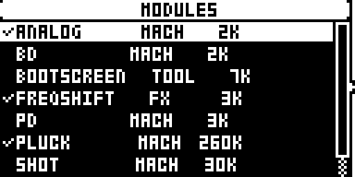
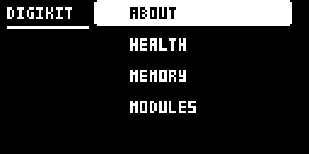
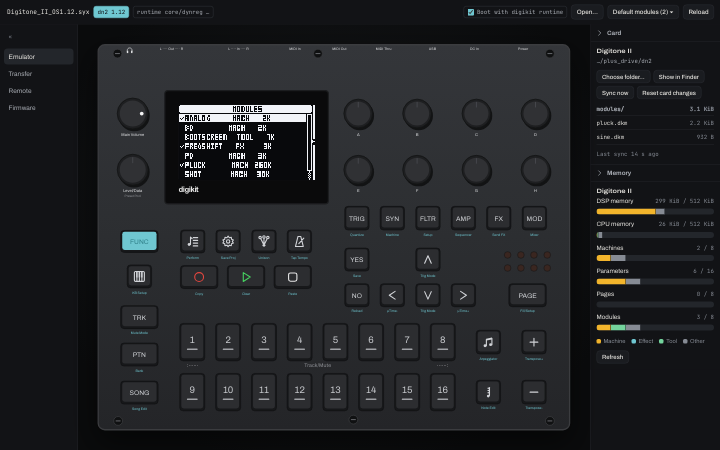
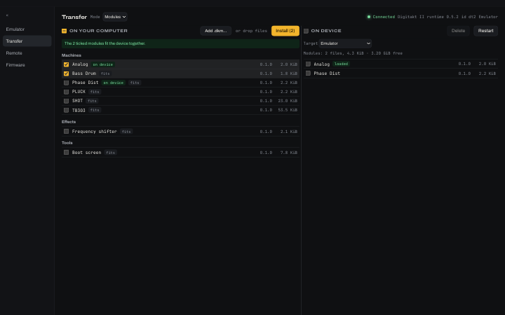
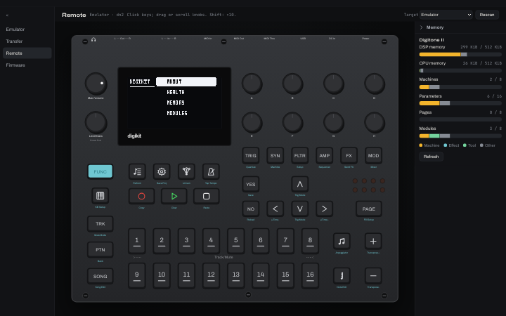

# digikit

New machines and effects for your Digitakt II and Digitone II.

digikit patches your own copy of the stock firmware once, with a small runtime. After that you load machines and effects as modules from the card, and change them without flashing again.

> 🧪 **digikit is experimental.** Flashing modified firmware is at your own risk. A stable release comes with 1.0.0.

[Open the site](https://eleklabs.github.io/digikit/) · [Browse modules](https://eleklabs.github.io/digikit/modules/)

## Screenshots

<!-- readme-shots:start -->
<table>
  <tr>
    <td align="center" valign="top"><a href="apps/web/public/images/device-modules.png"></a><br><sub>Pick which modules load</sub></td>
    <td align="center" valign="top"><a href="apps/web/public/images/device-digikit.png"></a><br><sub>About, health, memory, modules</sub></td>
  </tr>
</table>

<table>
  <tr>
    <td align="center" valign="top"><a href="docs/images/workbench-emulator.png"></a><br><sub>The real firmware on your computer</sub></td>
    <td align="center" valign="top"><a href="docs/images/workbench-transfer.png"></a><br><sub>Install modules over USB</sub></td>
    <td align="center" valign="top"><a href="docs/images/workbench-remote.png"></a><br><sub>Press keys and turn encoders from your computer</sub></td>
  </tr>
</table>
<!-- readme-shots:end -->

## Features

- New machine types next to the stock ones, with their own parameters and DSP code
- Up to 3 effects of your own, each with its own FX page, as a master insert or as a send effect with a send amount per track (SETTINGS > DIGIKIT > FX ROUTES)
- Modules load from the card at boot: install or change them over USB without flashing again
- Boot-loop protection: after two failed starts, the box starts without modules and shows why
- Safe mode: hold RECORD at power-on to start without modules
- A guard that mutes a misbehaving machine instead of silencing the whole device
- digikit keeps its modules and settings in its own area of the card, which the stock firmware never uses (82 MiB on the Digitakt II, about 22 GiB on the Digitone II), so your projects and kits stay stock
- A desktop emulator that runs the real firmware (ColdFire and SHARC DSP), for testing before you flash
- Remote control and debugging over USB: press keys, read the event log, peek at memory
- A module SDK and test suite, still in development

## Modules

Machines, effects and tools are loaded from the card at run time. The [Modules page](https://eleklabs.github.io/digikit/modules/) lists them, with their source, and installs them. Each module's own README is in its folder under [`modules/`](modules/).

## Quick start

You need Chrome or Edge, and your device's stock firmware file from Elektron's support site: **Digitakt II OS 1.17** or **Digitone II OS 1.12**.

1. On the [Firmware page](https://eleklabs.github.io/digikit/firmware/), choose your stock `.syx`. It is patched in the browser and not uploaded.
2. Flash it to the device over USB from the same page.
3. On the [Transfer page](https://eleklabs.github.io/digikit/transfer/), install modules. On the device, tick them in SETTINGS > DIGIKIT > MODULES and choose APPLY & RESTART.

digikit has run on a real Digitakt II. The Digitone II is tested in the emulator only.

## If something goes wrong

- If a module stops the box from starting, it starts without modules after two failed tries and shows why.
- Hold RECORD at power-on to start without modules. Then untick the module in SETTINGS > DIGIKIT > MODULES and restart.
- To remove digikit, flash your stock `.syx` the same way.
- If the device does not start at all, hold FUNC while powering on to reach the STARTUP menu, and send the stock OS over MIDI DIN ([details](docs/PATCHING.md#recovery)).

digikit never changes the bootloader. Keep your stock `.syx`.

## For developers

The repository also holds the desktop workbench, with the emulator, Transfer (modules and samples), Remote and Firmware pages, and the tools to build, test and load modules.

### Setup

You need [mise](https://mise.jdx.dev/) and [uv](https://docs.astral.sh/uv/). Then, once:

```sh
mise install
mise run setup              # Python and web dependencies
mise run patch:toolchains   # the compilers for module code
```

### Firmware files

Put `Digitakt_II_OS1.17.syx` and `Digitone_II_OS1.12.syx` in `firmware/`. No Elektron firmware is in this repository: you supply your own.

### Flash from the command line

```sh
mise run patch -- --firmware firmware/Digitakt_II_OS1.17.syx -o out/patch/digikit-dt2.syx
mise run patch:preflight -- out/patch/digikit-dt2.syx      # must print PREFLIGHT OK
```

Without `--modules`, the device's patch set from `devices/*.toml` is applied; `--set NAME` picks another. Only flash images that pass the preflight. Open Elektron Transfer, connect the device over USB, and drop the `.syx` on it while the device shows its main screen. When the transfer ends, the device asks to upgrade: press **YES**. After the restart, SETTINGS > DIGIKIT shows the runtime.

Some modules are patched into the image instead of loaded from the card, such as [Overdrive curves](modules/core/adapters/overdrive/README.md). [PATCHING.md](docs/PATCHING.md) has the details.

### Load a module on the device

With the runtime flashed and the device connected over USB:

```sh
mise run dk:run -- digikit/pluck --port Digitakt --seconds 60
```

This builds the module, uploads it, selects it, restarts the device and shows the log. Then pick **PLUCK** as the machine of a track. Useful while testing:

```sh
mise run dk:log -- --port Digitakt follow                       # follow the debug log (saved under out/runs/device-logs/)
mise run dk:log -- --port Digitakt level debug                  # log more: levels error, warn, info (default), debug, trace
mise run dk:screen -- --port Digitakt out/runs/shots/screen.png # a screenshot of the display
mise run dk:store -- --port Digitakt ls                         # the files of the store
```

### Run the emulator

```sh
mise run emu:ready -- dt2 --syx firmware/Digitakt_II_OS1.17.syx   # once: boot the firmware and save its state (about 2 minutes)
mise run workbench -- firmware/Digitakt_II_OS1.17.syx   # the stock firmware
mise run workbench -- out/patch/digikit-dt2.syx         # your patched image
```

The emulator's DSP does not run in real time yet, so audio plays slower than on the device. The `dk:*` commands work with the emulator too: use `--emu` instead of `--port Digitakt`.

### Write a module

Start with `mise run module:new -- machine AUTHOR/NAME` (or `fx`, `service`) and follow [the module guide](docs/MODULE-AUTHORING.md). `mise run module:check ID` runs the module's conformance tests and its own tests.

### Further reading

- [Writing modules](docs/MODULE-AUTHORING.md), the [SDK](sdk/README.md) and the [module reference](modules/README.md)
- [Patching, flashing and recovery in detail](docs/PATCHING.md)
- [Architecture](docs/ARCHITECTURE.md): the layers and what each may depend on
- [Developing digikit](docs/DEVELOPMENT.md): [previews](docs/DEVELOPMENT.md#visible-preview), [fast iteration](docs/DEVELOPMENT.md#fast-iteration-runtime-ui-and-modules), analysis tools, repository layout
- [Contributing](CONTRIBUTING.md)
- Project internals: [testing](docs/TESTING.md), [releasing](docs/RELEASING.md), [research findings](docs/FINDINGS.md)

## Licence

digikit ([github.com/ElekLabs/digikit](https://github.com/ElekLabs/digikit)) is licensed under
AGPL-3.0-or-later ([LICENSE](LICENSE)), with additional terms under section 7 of the AGPL
(attribution, origin and names) in [NOTICE](NOTICE). Keep NOTICE and the attribution
"digikit by Em D - https://github.com/ElekLabs/digikit" in copies and modified versions; a
user interface of a covered work shows it in its About, credits or footer area.

The licence covers the code here only; it gives no rights to Elektron's software or
firmware. digikit is not affiliated with or endorsed by Elektron. Digitakt, Digitone and
Syntakt are trademarks of Elektron Music Machines. Container format knowledge comes from
`mischa85/elektron-firmware-tool` (MIT); some architecture facts from
`lalzart/digitakt-ii-firmware-research-public`. The public SHARC+ assembler `ElekLabs/selache` (a fork of `js216/selache`)
is used only as a read-only cross-check. `tools/coldfire/ghidra/ColdfireEMAC` contains files from
Ghidra under the Apache License 2.0.
